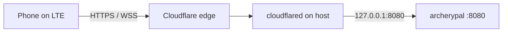

# Cloudflare Tunnel / custom domain (optional)

> **Production API today:** Cloudflare Workers at `https://archerypal-api.pauljreedii.workers.dev` — see [PUBLIC_API.md](PUBLIC_API.md).
>
> DuckDNS (`universeconflict.duckdns.org`) is **retired** for the Android app.
>
> Use this guide when you want a branded hostname such as **`https://api.archerypal.app`**.

## Option A — Workers custom domain (preferred)

In the Cloudflare dashboard: Workers → `archerypal-api` → Triggers → Custom Domains → add `api.archerypal.app`. Then set app `MATCH_SERVER_URL` and Worker `PUBLIC_WS_BASE` to that host and redeploy.

## Option B — Tunnel to a Go origin (legacy)

Expose a Go relay at **`https://api.archerypal.app`**.



## Prerequisites (Option B)

1. **Domain `archerypal.app` on Cloudflare** (DNS managed by Cloudflare).
2. **Relay running:** `archerypal.service` healthy on `127.0.0.1:8080`.
3. **SSH:** into the host that runs `cloudflared`.

## Step 1 — Create the tunnel (Cloudflare dashboard)

1. Open [Cloudflare Zero Trust](https://one.dash.cloudflare.com) → **Networks** → **Tunnels**.
2. **Create a tunnel** → choose **Cloudflared**.
3. Name: `archerypal`
4. **Public hostname** (add route):
   | Field | Value |
   |-------|--------|
   | Subdomain | `api` |
   | Domain | `archerypal.app` |
   | Type | HTTP |
   | URL | `127.0.0.1:8080` |
5. Save. Cloudflare shows a **connector install command** with a long token (`eyJ...`).
6. Copy the **token** only (the part after `install`).

Cloudflare creates the DNS record (`api` CNAME → tunnel) automatically.

## Step 2 — Install on host

From your dev machine:

```bash
scp server/deploy/setup-cloudflare-tunnel.sh server/deploy/cloudflared-archerypal.service z800:/tmp/
ssh z800
sudo bash /tmp/setup-cloudflare-tunnel.sh --token 'PASTE_TOKEN_HERE'
```

The script:

- Installs `cloudflared`
- Sets `LISTEN_ADDR=127.0.0.1:8080` (local only — tunnel is the public path)
- Sets `PUBLIC_WS_BASE=wss://api.archerypal.app`
- Enables `cloudflared-archerypal.service`

## Step 3 — Verify

```bash
curl https://api.archerypal.app/health
```

Expected: `{"status":"ok"}`

## Step 4 — App

| Build | Server URL |
|-------|------------|
| All builds | Update `MATCH_SERVER_URL` to `https://api.archerypal.app` |

Rebuild and install. **Contest** or **More** → server connected.

## WebSockets

Match sync uses `wss://api.archerypal.app/v1/room/...`.

## Troubleshooting

| Issue | Fix |
|-------|-----|
| `api.archerypal.app` NXDOMAIN | Add domain to Cloudflare; confirm DNS |
| 502 / tunnel error | Origin must be healthy on `127.0.0.1:8080` |
| Still using old URL in app | Rebuild after `build.gradle.kts` update |

## Files in repo

| File | Purpose |
|------|---------|
| `server/deploy/setup-cloudflare-tunnel.sh` | Install + configure host |
| `server/deploy/cloudflared-archerypal.service` | systemd unit (token mode) |
| `server/deploy/cloudflared-config.yml.example` | Config-file mode |
| `server/deploy/config.env.example` | `PUBLIC_WS_BASE` for Go origin |
