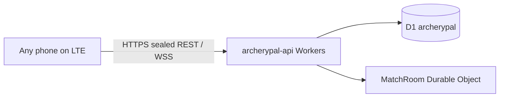

# Public API (Cloudflare Workers)

**Current production:** Archerypal API on **Cloudflare Workers** + D1 + Durable Objects.

Authenticated app traffic uses HMAC + sealed (AES-GCM) JSON bodies. Bootstrap routes require a shared app client key. Do not publish curl recipes for authenticated or bootstrap endpoints.

## How it works



### Already configured

- Worker deploy (`workers/`) — see [../workers/README.md](../workers/README.md)
- `PUBLIC_WS_BASE=wss://archerypal-api.pauljreedii.workers.dev`
- App `MATCH_SERVER_URL` = same URL (debug + release) in `app/build.gradle.kts`
- Weekly Cron shoot sync (TAC + Tri-County sources)
- Secrets (Wrangler): `JWT_SECRET`, `GOOGLE_OAUTH_CLIENT_ID`, `REVENUECAT_WEBHOOK_SECRET`, `APP_CLIENT_KEY`, optional `ADMIN_API_KEY`
- App local.properties: `archerypal.app.client.key` must match `APP_CLIENT_KEY` (debug default: `dev-app-client-key-change-me`)

### Verify (public only)

```bash
curl -s https://archerypal-api.pauljreedii.workers.dev/health
# {"status":"ok"}
```

Register / Google restore / Google sign-in reject requests without a valid `X-App-Key`. Authenticated `/v1/*` routes require `X-Device-Id` + HMAC and sealed JSON (`application/vnd.archerypal.sealed+json`).

## Deferred

- **Posts** — text-only create works (D1). Photo/media returns 501 until R2 is enabled
- **Custom domain** `api.archerypal.app` — optional; see [CLOUDFLARE_TUNNEL.md](CLOUDFLARE_TUNNEL.md) for branded hostname options
- **WebSocket frame sealing** — room sync remains JWT over WSS (not sealed envelopes)

## Legacy

- **DuckDNS** (`universeconflict.duckdns.org`) + RPIserver Incus Go relay — **retired** for the app
- **z800** bare-metal Go install — rollback copy only
- **Pi Tailscale Funnel** — not used by the app
