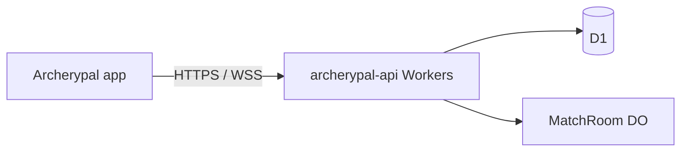

# Connecting the app to the match server

The Android app talks to the **Cloudflare Workers** API over **HTTPS** (REST) and **WSS** (live match sync via Durable Objects).

**Public URL:** `https://archerypal-api.pauljreedii.workers.dev`

DuckDNS / RPIserver app endpoints are **retired**. See [PUBLIC_API.md](PUBLIC_API.md) and [../workers/README.md](../workers/README.md).

## Architecture



| Layer | Purpose |
|-------|---------|
| `BuildConfig.MATCH_SERVER_URL` | `https://archerypal-api.pauljreedii.workers.dev` (debug + release) |
| `RemoteIdentityService` | Friend ID + device secret registration / Google link |
| `MatchServerApi` | REST with HMAC auth headers |
| `RemoteMatchTransport` | WebSocket relay |
| `NearbyMatchTransport` | Local field play |

## App configuration

```kotlin
buildConfigField("String", "MATCH_SERVER_URL", "\"https://archerypal-api.pauljreedii.workers.dev\"")
```

## Remote match flow (Plus)

| Step | Who | Action |
|------|-----|--------|
| 1 | Plus host | Challenge a friend |
| 2 | Host | Share invite link from host lobby (fallback) |
| 3 | Server | Sends FCM push when the target has a registered token ([FCM_SETUP.md](FCM_SETUP.md)) — FCM send may still be deferred on Workers |
| 4 | Friend | Tap notification or paste/open link → guest lobby |
| 5 | Both | WebSocket scoring |
| 6 | Host | Finish → `POST /v1/matches/{roomId}/complete` |

## Verify

```bash
curl -s https://archerypal-api.pauljreedii.workers.dev/health
# {"status":"ok"}
```

## Product IDs

See [PLAY_BILLING_SETUP.md](PLAY_BILLING_SETUP.md).
